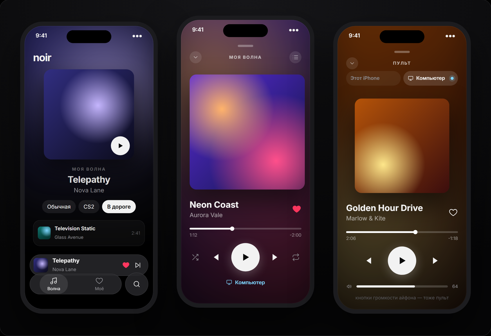

# Noir для iPhone

Чёрно-белый плеер Яндекс Музыки: мобильная версия [Noir](https://github.com/trualontuu/player) для Windows и пульт для него.



<sub>Макет: треки и обложки выдуманные.</sub>

Expo SDK 58 · React Native · Expo Router (родные вкладки iOS 26) · `expo-audio` · Cloudflare Durable Objects.

## Что умеет

- **Моя волна** с характером, настроением и своими сценами: «CS2» и «В дороге», где волна собрана от выбранных артистов. Отзывы о треках уходят в Яндекс, как в официальном приложении.
- **Мне нравится**, плейлисты, альбомы, артисты и поиск. Долгое нажатие на трек открывает меню: «играть следующим», лайк, скачать, перейти к артисту или альбому.
- **Скачивание треков**: по одному или целым плейлистом. Скачанное играет без интернета.
- Музыка играет **в фоне и на заблокированном экране**, работают карточка в Пункте управления и кнопки наушников. Следующий трек включает сама iOS через `AVQueuePlayer`, приложению не нужно просыпаться.
- **Плавный переход** между треками (затухание и нарастание, от 0 до 10 с), пауза без щелчка, **ровная громкость** по LUFS.
- **Пульт для компьютера**, как Spotify Connect. Когда на ПК запущен Noir, телефон показывает, что там играет, и управляет им: пауза, треки, лайк, перемотка, громкость. Кнопки громкости айфона тоже меняют громкость компьютера. Работает и не из одной сети.
- **Обновления по воздуху** (EAS Update): новые версии интерфейса приходят сами, без переустановки.
- Цвета кнопок и свечение фона берутся из обложки играющего трека. Можно выбрать и строгий чёрно-белый режим.
- Вход по коду с ya.ru/device, пароль приложение не видит. Токен хранится в Keychain.

## Как устроен пульт

```
Noir на ПК (host) ──┐                         ┌── Noir на iPhone (remote)
                    └─ wss ─► Noir Connect ◄─ wss ─┘
                              Cloudflare Worker + Durable Object
```

Комната одна на аккаунт Яндекса. Ретранслятор по токену из заголовка спрашивает у Яндекса uid и кладёт соединение в Durable Object этого uid. Сам токен он не хранит, а в памяти держит только sha-256 от него. Компьютер присылает состояние (трек, позиция, громкость), телефон присылает команды. Код ретранслятора лежит в [`connect/`](connect).

## Разработка

```
npm install
npx expo start          # Expo Go на iPhone по QR-коду (кроме кнопок громкости → ПК: им нужна своя сборка)
npm run typecheck
npx eslint src
```

## Установка без Mac и без платного аккаунта

1. GitHub → Actions → **iOS build** → *Run workflow*. Примерно через 25 минут в артефактах появится `Noir.ipa` без подписи.
2. Поставить через [SideStore](https://sidestore.io) («+» в My Apps) или [Sideloadly](https://sideloadly.io) с обычным Apple ID.

Бесплатная подпись живёт 7 дней, SideStore продлевает её прямо на телефоне.

Обновления:
- `scripts/ota.ps1 -Message "…"` — изменения в JS приходят по воздуху во все установленные копии той же версии;
- `scripts/publish-ipa.ps1` — выкладывает свежую ipa в источник SideStore. Нужен при изменениях в нативных модулях, вместе с повышением `version`.

> Noir — неофициальный клиент. Он не связан с Яндексом и не обходит защиту контента.
